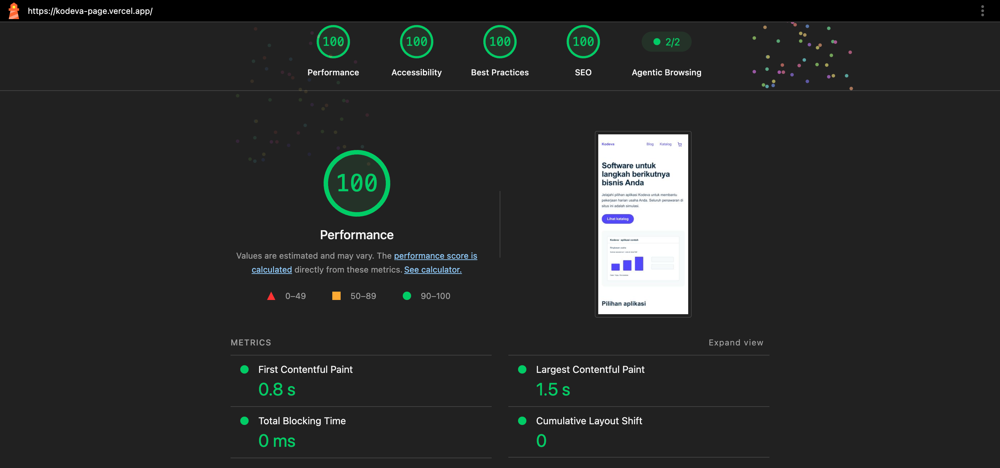

# Kodeva — Promo Akhir Tahun

A fictional software storefront for Indonesian UMKM, built for the **PT Digital Solusi Grup — Fullstack Developer Technical Skill Test**. The project combines a marketing-managed campaign website and blog with an interactive, frontend-only mini marketplace.

**Live demo:** [Website](https://kodeva-page.vercel.app/) · [CMS Studio](https://kodeva-admin.sanity.studio/) · [Source repository](https://github.com/arathfal/dsg-kodeva)

> **Assessment scope:** The marketplace checkout and payment are intentionally simulated. Apart from content editing through Sanity Studio, the web application's only server-side write is lead capture; there is no real order processing, payment gateway, or license fulfillment.

## Implemented features

The sections below follow [the assessment brief](ASSESSMENT_BRIEF.md). Implementation history, approvals, and detailed test notes are available in [TASKS.md](TASKS.md) and [DECISIONS.md](DECISIONS.md), rather than repeated here.

### A. Campaign website, blog, and CMS

- **Campaign landing page:** hero banner, CTA to the catalog, featured products, testimonials, FAQ, and a lead form. Marketing can update the content, images, and featured-product descriptions/features in Sanity without changing application code. Product identities, package prices, and commerce rules remain code-owned.
- **Lead capture:** name and email and/or WhatsApp, with server-side validation, input limits, and a honeypot. Submissions are stored in a **private Sanity dataset** and are viewable in the **Lead Kodeva** Studio workspace. This workspace is read-only **at the Studio UI level**; the UI restriction is not a substitute for dataset permissions.
- **Blog:** article listing with six items per page, pagination, readable article slugs, cover images, categories, and safe rich text. Articles can link to products in the marketplace. Drafts are excluded from public responses.
- **Content publishing:** published changes, slug updates, and unpublishing are reflected on subsequent website requests **without a manual redeploy**. CMS data is read on demand using Sanity's published perspective and `no-store` caching. This favors freshness over caching efficiency and depends on CMS availability.
- **Search and sharing:** page-specific titles/descriptions, canonical URLs, Open Graph metadata, article metadata, and raster social preview images for sharing (including WhatsApp).

**Main routes:** `/`, `/blog`, `/blog/halaman/N`, `/blog/[slug]`.

For editor field details and publishing rules, see the [CMS content contract](tasks/T02-cms.md#approved-content-contract).

### B. Mini marketplace (frontend only)

- **Catalog:** six fictional products, category-based filters that also work without client-side JavaScript, and empty/not-found states.
- **Product details:** feature screenshots, regular and promotional prices, remaining promotional-license quota, and Basic/Pro/Business package selection with immediate price updates.
- **Cart:** add, change quantity, and remove products; calculated subtotal and a cart badge accessible from every public page. Items persist across refreshes using a validated Zustand store.
- **Shared promotional quota:** quantities across different packages of the **same product** count toward one quota. Cart changes and restored data are revalidated against the product fixtures, rather than trusting persisted prices or totals.
- **Checkout simulation:** buyer name/email validation, order summary, mock order payload, deterministic success/failure selection, pending state, duplicate-submit protection, and retry after failure. Successful checkout clears the cart.
- **Responsive and accessible interactions:** mobile layouts, keyboard-operable controls, validation feedback, and loading/error/empty handling. The implementation was checked at narrow mobile widths, including 320px and 360px.

**Main routes:** `/products`, `/products/[id]`, `/cart`, `/checkout`. Product records, prices, packages, and quota are managed in TypeScript fixtures; they are **not** a live inventory service.

### C. Marketing attribution and performance

- **GA4-style `dataLayer` events:** `landing_cta_click`, `view_item`, `add_to_cart`, and `begin_checkout`. They fire on the relevant user action or page load, not on arbitrary React rerenders. No Google Analytics account or live collection endpoint is configured.
- **UTM attribution:** captures valid `utm_source`, `utm_medium`, `utm_campaign`, `utm_term`, and `utm_content` as the first touch within a browser tab session. Attribution survives page navigation and is included in stored leads and mock checkout-order payloads; buyer personal data is excluded from analytics events.
- **Mobile performance:** **Lighthouse Performance 100** on the deployed landing page (final submitted evidence; QA-era runs 97–99), above the assessment target of 80.

### Bonus: shareable catalog state (search, filter, price sort)

Optional brief item, implemented on top of the required catalog:

- **Everything lives in the URL.** The catalog defaults are unchanged; three composeable parameters describe any catalog view: `kategori` (existing), `q` (search text), and `harga=termahal|termurah` (price ordering). Sharing `/products?kategori=sdm-payroll&q=gaji&harga=termahal` re-renders the same filtered, on-order view on a fresh load. The controls are plain links and one GET form; a small owner-directed debounce script (300 ms) submits typed searches in real time and submits sort changes immediately, trimmed so shared URLs carry no empty-parameter noise. Without JavaScript a visible fallback submit button appears, and the server-rendered result is identical.
- **Search and sort in one filter bar** (owner-directed reference layout with follow-up corrections): a full-width rounded search input with a magnifier icon; category chips scroll horizontally in one line with the scrollbar hidden, and a vertical divider sits exactly between the chip row and the `Urutkan` popup (disclosure with "Harga Terendah"/"Harga Tertinggi" options; the trigger shows the chosen option with a ✕ clear action, defaulting to just "Urutkan"); on mobile the category row and the sort control stack vertically. A "Menampilkan N produk" result count is shown. Categories use a **light-purple tint of the primary color** for the active chip, so filters stay visually distinct from filled primary buttons; category chips carry no icons.
- **Sorting** uses each product's Basic starting price (the price the cards and detail page introduce). Without `?harga`, the catalog keeps the approved fixture order — the default view is not reordered, and the picker's **Bawaan** option returns to it.
- **Search** matches a product's name, summary description, and features (the text its card shows); case-insensitive, trimmed, and capped at 100 characters so request URLs stay reasonable. A blank search means "no filter".
- **State preservation between controls.** Category chips keep the active `q`/`harga`; the shared GET form submits `q` and `harga` together with `kategori` via a hidden input. The no-results state offers a "Hapus pencarian" link that removes only the search term.
- **Unknown inputs fail soft where the original contract says so.** Unknown `kategori` values still return 404 as approved; unknown `harga` values and blank/oversized searches fall back to the default view instead of erroring, and are dropped from regenerated shareable links. Interpolated search text is HTML-escaped by Astro.
- **Canonical URLs intentionally stay at `/products`** so a filtered view is shareable without one indexed URL per state; no tracking events fire from filter/search/sort usage, matching the catalog's event contract.
- **Verification:** 7 new tests in `shared/catalog.test.ts` (ordering, search matching, composition, argument-validation and URL-building edge cases); all six suites still pass; format/lint/typecheck/build clean; browser checks confirmed each parameter composes in the URL, debounced real-time search and sort changes, state preservation between controls, the empty-search state, unknown-value fallbacks, 404 behaviour and 320/360px layouts without horizontal overflow.


## Architecture and technical decisions

| Area | Implementation | Reason |
| --- | --- | --- |
| Web application | Astro + TypeScript | Server-rendered content and SEO with limited browser JavaScript |
| Interactive UI | React islands | Hydrate package selection, cart, and checkout while keeping catalog filters server-rendered |
| Styling | Tailwind CSS v4 | Consistent responsive styling, based on [DESIGN.md](DESIGN.md) |
| CMS | Sanity Studio + Content Lake | Non-technical editing, publication workflow, and separate content/lead datasets |
| Cart state | Zustand `persist` + validated TypeScript logic | Refresh persistence without trusting browser-stored amounts or quantities |
| Workspace | pnpm monorepo (`apps/web`, `apps/studio`) | Manage the website and Studio together while deploying independently |
| Hosting | Vercel (web), Sanity (Studio) | Managed deployment suited to the assessment scope |
| Tests | Node.js test runner + browser checks | Validate commerce rules and critical user journeys |

Astro reads published marketing content at request time through typed server-side Sanity queries, with `cache: no-store` and no-store response headers. This avoids waiting for a redeploy, but increases CMS requests and means campaign/blog pages may return an explicit unavailable response if Sanity is down. The fixture-driven catalog can still be served in that situation. Marketing edits do not change the code-owned product pricing rules.

The one-app storefront structure is intentional for the current scope; introducing a separate marketplace frontend or backend would add deployment and integration complexity without being required by the brief. Production backend integration is outlined below, not implemented.

## Deployed demo and CMS access

- **Website:** <https://kodeva-page.vercel.app/> — deployed to Vercel from GitHub, with `PUBLIC_SITE_URL` configured for canonical and social metadata.
- **Sanity Studio:** <https://kodeva-admin.sanity.studio/> — hosted on Sanity. Redirecting to Sanity's sign-in/hosted Studio flow is expected.
- **Editor demo account:** credentials are **provided separately with the assessment submission**, never committed to the repository. Use **Continue with email** to sign in, then open **Konten Kodeva** to edit Kampanye, Artikel, and Kategori. **Lead Kodeva** is the read-only inspection workspace for lead submissions.

The deployed Studio's Editor sign-in, workspace access, and content creation availability were checked on **1 November 2026**. Published-content freshness, draft isolation, lead writing, and anonymous lead-data privacy were also exercised during QA. Temporary testing records were deleted afterward.

## Run locally

**Requirements:** Node.js `>=24.16.0 <25` (the included `.nvmrc` selects `24.22.2`), pnpm `10.13.1`, and access to the configured Sanity project.

```sh
nvm install
nvm use
corepack enable
corepack prepare pnpm@10.13.1 --activate
pnpm install --frozen-lockfile

cp apps/web/.env.example apps/web/.env.local
cp apps/studio/.env.example apps/studio/.env.local

pnpm dev
```

- **Web:** <http://localhost:4321> (`pnpm dev:web`)
- **Studio:** <http://localhost:3333> (`pnpm dev:studio`)

Fill the copied environment files with the project and dataset values. The web app uses `SANITY_PROJECT_ID`, `SANITY_DATASET`, `SANITY_LEADS_DATASET`, and `PUBLIC_SITE_URL`; the Studio uses `SANITY_STUDIO_PROJECT_ID`, `SANITY_STUDIO_DATASET`, and `SANITY_STUDIO_LEADS_DATASET`. The demo uses a **public `production` content dataset** and a **private `leads` dataset**. Configure the local Studio origin in Sanity CORS settings and sign in to edit content.

Lead submissions require the server-only `SANITY_LEADS_WRITE_TOKEN` in `apps/web/.env.local` (and in Vercel's server-side environment when deployed). **Do not add the token to the repo or expose it with a `PUBLIC_` or `SANITY_STUDIO_` prefix.** The token's actual scope must be reviewed before production use; a functional demo write credential does not establish least-privilege access.

To populate an **empty** content dataset with the included fictional demo material, authenticate with Sanity CLI and run the seed script. The first invocation is a dry run:

```sh
pnpm --filter @kodeva/studio exec sanity login
pnpm --filter @kodeva/studio exec sanity exec scripts/seed.ts --with-user-token
pnpm --filter @kodeva/studio exec sanity exec scripts/seed.ts --with-user-token -- --write
```

The write command is optional and intentionally guarded against overwriting existing editor content. No real customer or payment data is required.

## Verification

Run the project checks from the repository root:

```sh
pnpm format:check
pnpm lint
pnpm typecheck
pnpm test:cms
pnpm test:catalog
pnpm test:leads
pnpm test:cart
pnpm test:checkout
pnpm test:attribution
pnpm build
```

The recorded final QA passed **109 Node tests across six suites**, lint, formatting, type checking, and production builds. Browser checks covered landing-to-product-to-checkout journeys, form validation, quota across package combinations, cart persistence/recovery, mock payment results, UTM attribution, tracking-event counts, CMS publication, lead storage/privacy, and mobile overflow. The live Vercel deployment was separately checked for metadata, lead behavior, headers, and Lighthouse performance. See [TASKS.md](TASKS.md), [DECISIONS.md](DECISIONS.md), and [TIME_LOG.md](TIME_LOG.md) for detailed execution records.

### Lighthouse mobile evidence



- **Tested URL:** <https://kodeva-page.vercel.app/>
- **Date:** 1 November 2026, 11:09 WIB; Lighthouse 13.6.0, mobile emulation.
- **Result:** Performance **100** (LCP 1.5 s, TBT 0 ms, CLS 0). Earlier QA-era runs recorded 97 (local production runner), 99 (deployed final during T09), and 100 (pre-env-fix deployed run); the run above is the final submitted evidence.
- **Report:** [Lighthouse HTML](evidence/lighthouse/lh-landing-mobile-deployed-final-report.html) · [raw JSON](evidence/lighthouse/lh-landing-mobile-deployed-final-report.json).

## Working time

**Recorded active-work intervals: approximately 5 hours 29 minutes 18 seconds**, covering planning, implementation, review, QA, deployed verification, and the developer-confirmed submission-documentation session on 1 November 2026. This is **not claimed as the complete actual active-work total**: the submission-documentation window was developer-confirmed (~23 minutes), but earlier owner review/handoff intervals, owner-side UI editing, and the final commit/submission tails were not continuously timed. Unknown intervals have not been counted as zero.

The detailed session ledger and its timing caveats are in [TIME_LOG.md](TIME_LOG.md). The remaining unknown intervals stay disclosed rather than silently added to or removed from this figure. A later owner-assigned bonus session on 1 November 2026 (shareable catalog state, session S-036) ran an additional observed window that is recorded in the ledger but **not developer-confirmed and not included in the total above**.

## Assumptions, limitations, and next steps

### Assumptions and scope

- All brand, product, pricing, testimonial, and contact details are **fictional assessment data**. Test lead records were removed after verification.
- Marketing controls campaign and blog content in Sanity; the product catalog, prices, packages, and promo quota are fixtures in code.
- Checkout and payment are simulations. A successful mock checkout does **not** decrement shared promo quota or guarantee inventory across different shoppers.
- UTM attribution is **first-touch per tab session**, not a permanent cross-device attribution model; if session storage is unavailable, attribution falls back to in-memory state for the current page. GA4-style events are pushed to `dataLayer` only.
- The website currently supports **Indonesian and IDR**. Malaysia/Singapore expansion was treated as future context, not a requirement to launch multiple locales in this assessment.
- Published slug changes have no automatic redirect; invalid or missing article/product routes return not-found. CMS drafts are not publicly exposed.

### Not implemented

A real order/payment backend, payment gateway, database-backed promo reservation, and license fulfillment are **outside the required frontend-only marketplace scope**. The cart persists within a tab when local storage is available, but does not synchronize across tabs; blocked storage falls back to in-memory state. Other deferred improvements include designed 404 page, favicon/robots/sitemap, CMS draft preview, scheduled campaigns, vouchers, multiple billing durations, and localization. These are not presented as completed features.

### If I had one more week

1. Add production polish: branded not-found page, favicon, robots/sitemap, and cross-tab cart synchronization.
2. Build a small order/payment backend proof of concept with server-side quotes, payment states, and concurrency-safe promo reservations.
3. Add marketer-oriented CMS draft preview and scheduled campaign publishing.
4. Extend the storefront with voucher support and groundwork for Malaysia/Singapore localization.

## Production backend integration plan (proposal only)

The demo deliberately has **no marketplace backend**. A real implementation would make the server the authority for prices, promo quota, order state, and license delivery.

| Endpoint | Responsibility |
| --- | --- |
| `GET /api/products` | Read authoritative products, packages, prices, and promo availability |
| `POST /api/cart/quote` | Validate quantities and prices against server records |
| `POST /api/orders` | Create an idempotent order and reserve promo quota transactionally |
| `POST /api/payments/initialize` | Create a gateway payment session server-side |
| `POST /api/payments/webhook` | Verify gateway callbacks and apply allowed order-state transitions |
| `GET /api/orders/:id` | Return authoritative order/payment/fulfillment status |
| Internal fulfillment job | Generate/assign purchased licenses and deliver them to the buyer |

**Secure payment flow.** The browser sends cart items, not trusted totals, to the server. The server validates the quote, creates a `PENDING_PAYMENT` order with an idempotency key, and initializes the payment session using server-only credentials. The gateway's webhook is verified using the provider's signature scheme and relevant freshness checks; the payment reference, amount, and currency must match the order. Duplicate or delayed webhook events must not repeat transitions. The UI polls or fetches the server's order status rather than treating a frontend redirect as proof of payment.

**Accurate promo quota.** The database tracks available and reserved units **per product across all packages**. Creating an order conditionally reserves quota inside a transaction, preventing two buyers from overselling the same remaining units. Successful payment consumes the reservation; failed/expired payment releases it with idempotent state transitions.

**License fulfillment.** A verified paid order queues an idempotent fulfillment job. A worker generates or allocates licenses, associates them with the buyer, sends a receipt/license message, and records fulfillment status. A transactional outbox and retries make delivery resilient to webhook/worker failures. None of this is part of the submitted demo implementation.

## Project documentation

- [Assessment brief](ASSESSMENT_BRIEF.md) — original requirements.
- [PRD](PRD.md) — requirement breakdown and acceptance criteria.
- [DESIGN](DESIGN.md) — interface and design-system reference.
- [TASKS](TASKS.md) — detailed task history and implementation notes.
- [DECISIONS](DECISIONS.md) — architectural choices, approvals, and trade-offs.
- [TIME_LOG](TIME_LOG.md) — recorded work sessions and timing calculations.
- [AI_LOG](AI_LOG.md) — AI tools, important prompts, corrections, and verification.
- [AGENTS](AGENTS.md) — development and review rules.
- [Compatibility patch notes](patches/README.md) — pinned formatter-compatibility patch needed when installing from the lockfile.
